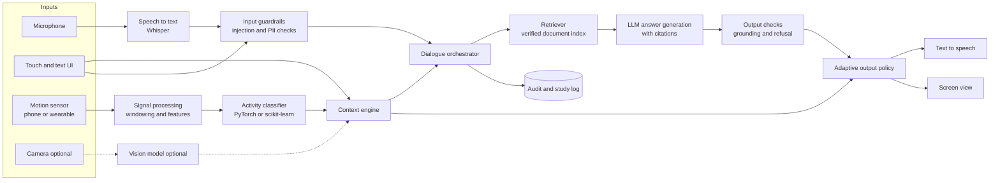

# Multimodal Context-Aware Assistant


A planned Python research prototype of an assistant that gives **safe, short, situation-appropriate information** to people whose hands and attention are busy: a field technician repairing a machine, a care worker on a ward round, or (in simulation only) a vehicle driver. It combines **voice, touch/text and one sensor stream** (smartphone or wearable motion data, optionally a camera), infers what the user is currently doing, and answers questions with an LLM that may only use **retrieved, verified documents**, citing its sources and refusing when the evidence is missing. Output is adapted to context: a one-sentence spoken reply while the user is working, a detailed on-screen answer when they are idle.

> **Status: planning and design phase.** This repository contains documentation only: requirements, features, architecture, evaluation protocol and reporting plan. Nothing is implemented yet. Every feature below is **planned**.

## Motivation

Standard chatbots assume a user sitting at a desk, reading long text. In real work settings that assumption breaks: a technician holding a tool cannot scroll, and a care worker needs one correct, sourced instruction rather than a paragraph that might be hallucinated. Wrong information in these settings has real consequences. This project asks a concrete question:

> Does an assistant that senses the user's situation and adapts *what* it says and *how* it says it (modality, length, timing) reduce task time and errors and increase appropriate trust, compared with a plain text chatbot over the same verified documents?

It is also built as a portfolio piece that shows signal processing and ML, multimodal UI design, secure LLM integration, and scientific evaluation and writing in one project.

## Key Features (planned)

- **Activity and context recognition.** A PyTorch / scikit-learn model classifies activity (e.g. walking, standing, hands busy) from accelerometer and gyroscope windows, trained on public datasets (UCI HAR, WISDM) and fine-tuned on a short recording of the target task.
- **Speech input.** Local speech-to-text with OpenAI Whisper (open-source, MIT-licensed) or `faster-whisper`, with push-to-talk and wake-word options.
- **Context engine.** Fuses activity, UI state, task step and noise level into a context state (e.g. `HANDS_BUSY`, `MOVING`, `IDLE`, `NOISY`).
- **Adaptive output policy.** Chooses modality (voice, screen, both), length and level of detail from the context state.
- **Verified-docs RAG.** Retrieval only over an approved, versioned document set (manuals, SOPs, care guidelines), with citations for every claim.
- **Refusal and escalation.** Says "I can't confirm this from the approved documents" when evidence is weak, and suggests who to ask.
- **Security guardrails.** Prompt-injection detection on queries and documents, output checks, PII redaction, audit log.
- **Web/tablet UI.** Large-target touch UI with voice, accessible (WCAG 2.1 AA as target), step-by-step task view.
- **Configurable scenarios.** Technician (default) and care worker scenarios as config files; a driver scenario for simulator-only use.
- **Study mode.** Switch between *context-aware* and *plain chatbot* conditions, with logging for task time, errors and questionnaires.

See [docs/FEATURES.md](docs/FEATURES.md) for the full list with acceptance criteria.

## Architecture



Details in [docs/ARCHITECTURE.md](docs/ARCHITECTURE.md).

## Tech Stack (planned)

| Area | Choice |
|---|---|
| Language | Python 3.11+ |
| Signal processing and ML | NumPy, SciPy, pandas, scikit-learn, PyTorch |
| Datasets | UCI HAR (30 subjects, 6 activities, 50 Hz), WISDM Smartphone and Smartwatch (51 subjects, 18 activities, 20 Hz) |
| Speech | Whisper / faster-whisper (STT), Piper or a cloud TTS (TTS) |
| LLM and RAG | Local model via Ollama or vLLM, or an EU-hosted API; LlamaIndex or a small custom pipeline; pgvector or Qdrant |
| Backend | FastAPI, WebSockets, PostgreSQL |
| Frontend | Next.js (React), Web Speech / WebRTC audio, PWA for tablets |
| Sensor bridge | Phone sensor app streaming over WebSocket, or Web DeviceMotion API |
| Evaluation | Ragas-style grounding metrics, pytest, statsmodels, pingouin |
| Writing | LaTeX (ACM `acmart` or IEEE template), Overleaf |

## Roadmap (8 to 10 weeks)

| Week | Milestone |
|---|---|
| 1 | Scenario choice, requirements, document set, ethics/consent material, study pre-registration draft |
| 2 to 3 | M1: Activity recognition baseline on UCI HAR and WISDM; sensor streaming from phone |
| 3 to 4 | M2: Verified-docs RAG with citations, refusal and guardrails; red-team test set |
| 4 to 5 | M3: Speech input, context engine, adaptive output policy |
| 5 to 6 | M4: Tablet UI with voice and touch; study mode with both conditions |
| 7 | M5: Pilot test (2 people), fixes, then user study with 8 to 12 participants |
| 8 to 9 | M6: Analysis, paper draft in conference format, technical documentation |
| 10 | M7: Buffer, polish, release v0.1, publish report |

## Getting Started (planned)

Not runnable yet. The intended workflow:

```bash
git clone https://github.com/mahmudul-islam32/multimodal-context-aware-assistant.git
cd multimodal-context-aware-assistant
python -m venv .venv && source .venv/bin/activate
pip install -e ".[dev]"
python -m mcaa.data.download --dataset uci-har    # planned
python -m mcaa.har.train --config configs/har.yaml  # planned
docker compose up                                   # planned: API, vector DB, UI
```

## Documentation

- [Features](docs/FEATURES.md)
- [Architecture](docs/ARCHITECTURE.md)
- [Evaluation and user study](docs/EVALUATION.md)
- [Reporting and reproducibility](docs/REPORTING.md)

## Contributing

The project is in design. Issues with feedback on the features, the study design or the safety approach are welcome. Once code exists, please open an issue before a large pull request, follow `ruff` formatting and add tests.

## Author

Mahmudul Islam, M.Sc. Computer Science, backend and full-stack engineer with LLM/RAG systems in production at CIVIS.digital. GitHub: [@mahmudul-islam32](https://github.com/mahmudul-islam32)

## License

[MIT](LICENSE)
