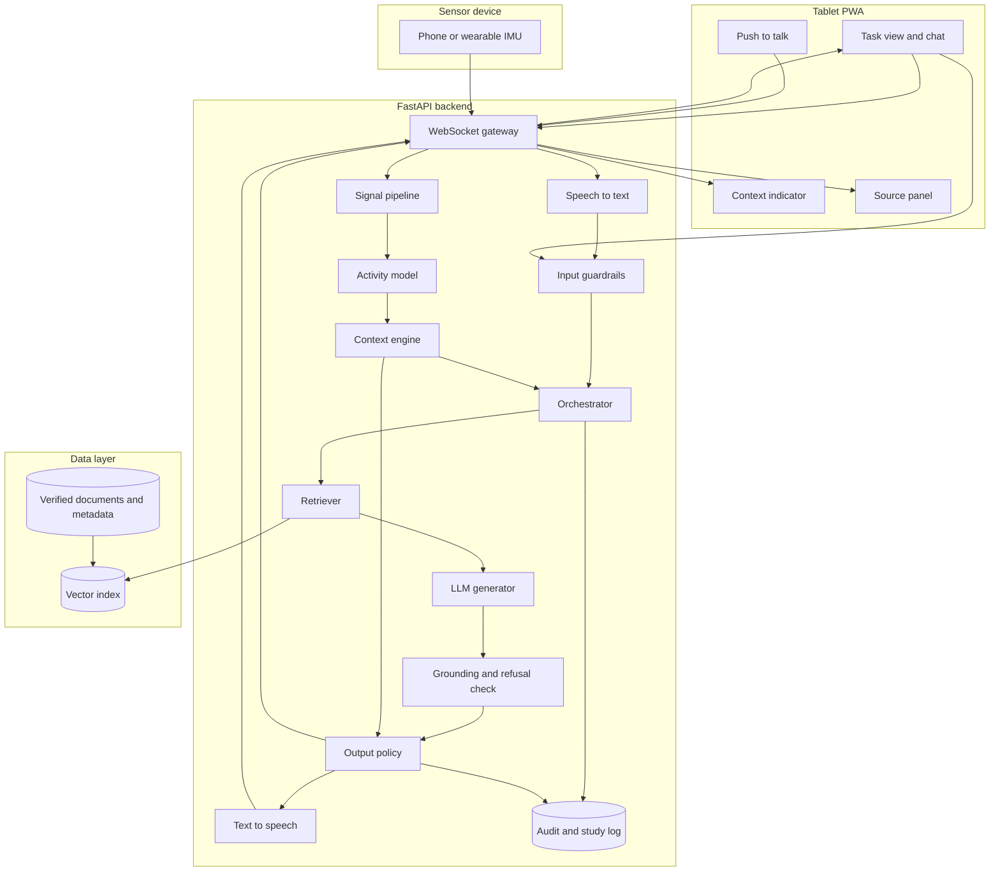
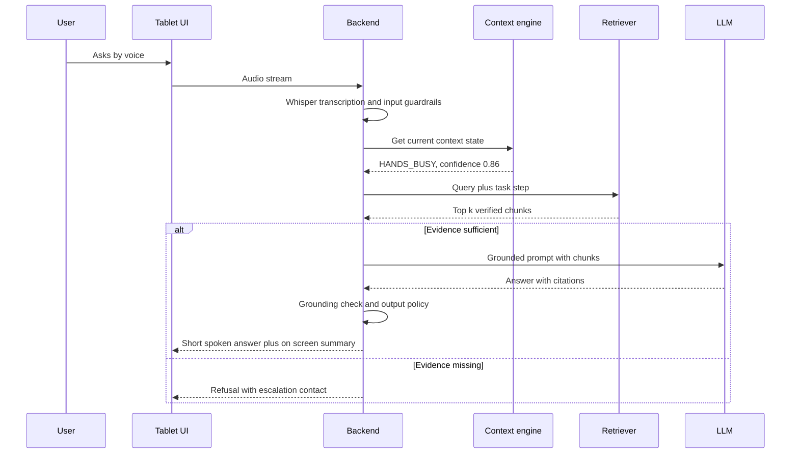

# Architecture: multimodal-context-aware-assistant

> Status: implemented in v0.1. Deviations from the original plan: the event log uses SQLite rather than PostgreSQL; retrieval is an in-process hybrid BM25 + TF-IDF index rather than pgvector or Qdrant; the UI is a static PWA rather than Next.js; the grounding check is lexical (content words and exact numbers) rather than NLI.

## Goals and constraints

- **Safety first:** answers only from verified documents; refuse rather than guess.
- **Low interaction cost:** usable with busy hands and divided attention.
- **Explainable adaptation:** every adaptation decision is driven by an explicit, logged context state.
- **Privacy:** local processing by default; no raw audio/sensor data leaves the device or lab server without consent.
- **Study-ready:** both experimental conditions share all components except the adaptive policy.

## Component overview



## Request flow



## Components

| Component | Responsibility | Technology (planned → v0.1) |
|---|---|---|
| Sensor bridge | Stream IMU data with timestamps | Phone app or browser DeviceMotion API, WebSocket |
| Signal pipeline | Resample, low-pass filter, windowing, features | NumPy, SciPy |
| Activity model | Classify activity per window | scikit-learn baseline, PyTorch 1D-CNN |
| Speech to text | Transcribe utterances | Whisper / faster-whisper, VAD |
| Context engine | Fuse cues into a context state with hysteresis | Python state machine, YAML rules |
| Input guardrails | Injection heuristics/classifier, PII redaction | Rules plus small classifier, Presidio-style redaction |
| Retriever | Hybrid search over verified chunks | pgvector or Qdrant, BM25 |
| LLM generator | Grounded answer with citations, structured output | Local model (Ollama/vLLM) or EU-hosted API |
| Grounding check | Verify each claim against cited chunks; trigger refusal | NLI or LLM-as-judge with thresholds |
| Output policy | Modality, length, detail | Versioned YAML policy |
| Text to speech | Spoken output, barge-in | Piper or equivalent |
| Audit and study log | Events for safety audit and analysis | PostgreSQL, Parquet export |

## Context states (initial)

| State | Cues | Output |
|---|---|---|
| `IDLE` | Standing/sitting, recent touch | Full answer on screen, voice optional |
| `HANDS_BUSY` | Task step marked manual, activity "working", no touch > 20 s | Voice first, ≤ 25 words |
| `MOVING` | Walking detected | Voice first, very short, defer details |
| `NOISY` | High ambient level, low ASR confidence | Screen first, visual cue |

## Security model

- Documents are data, never instructions: retrieved text is quoted inside delimited blocks and the system prompt states this.
- The LLM has no tools besides retrieval; no web access.
- Injection attempts in queries and documents are detected and logged; documents with injection markers are quarantined at ingestion.
- Threat model and red-team results are part of the technical report.

## Privacy and data flow

- Audio is transcribed locally; raw audio is discarded unless the participant consents to recording.
- Sensor data is stored only in study mode, pseudonymised by participant ID.
- If an external LLM API is used, only redacted query text and document chunks are sent, to an EU-hosted endpoint.
- Retention and deletion procedures are described in [EVALUATION.md](EVALUATION.md).

## Repository layout (v0.1)

```text
src/mcaa/
  sensors/      # streaming, preprocessing
  har/          # activity models, training
  speech/       # ASR, TTS
  context/      # context engine
  rag/          # ingestion, retrieval, generation, guardrails
  policy/       # adaptive output policy
  api/          # FastAPI app
  study/        # conditions, logging, export
  vision/       # optional camera context
  web/static/   # PWA (HTML/JS), phone sensor page
configs/        # scenarios, context rules, policy, HAR
data/docs/      # approved sample documents per scenario
eval/           # gold questions, red-team set, study analysis
scripts/        # figures and demo recording
results/        # evaluation report
docs/
```
